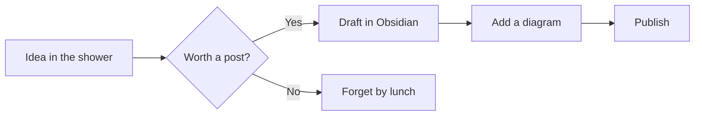
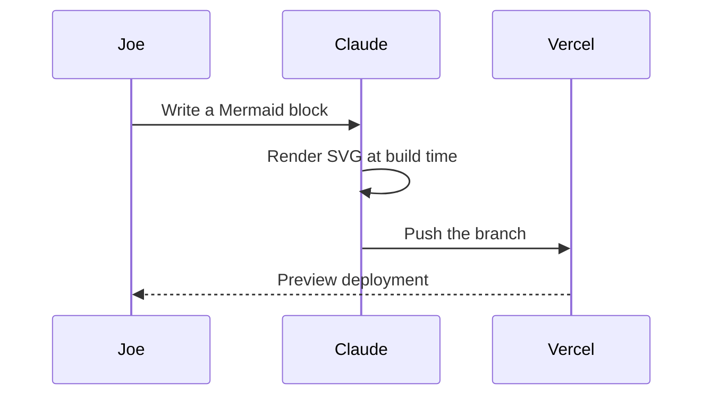
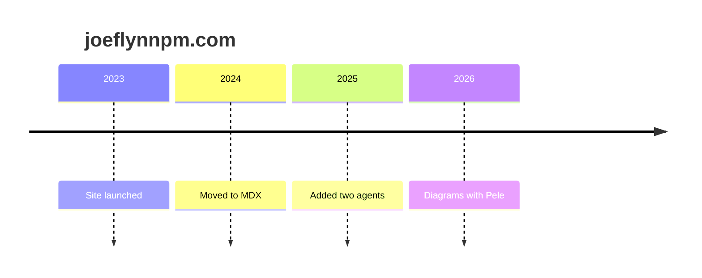

A draft for checking diagrams. It shows in `npm run dev` and is hidden in production.

## Flowchart

Left to right on a wide screen. On a phone it switches to top to bottom.



## Sequence diagram



## Timeline



## Broken on purpose

This one has a syntax error, so it should show as a plain code block (and log a warning during the build) rather than breaking the page.

```mermaid
flowchart TD
  A[Start] -->
```
